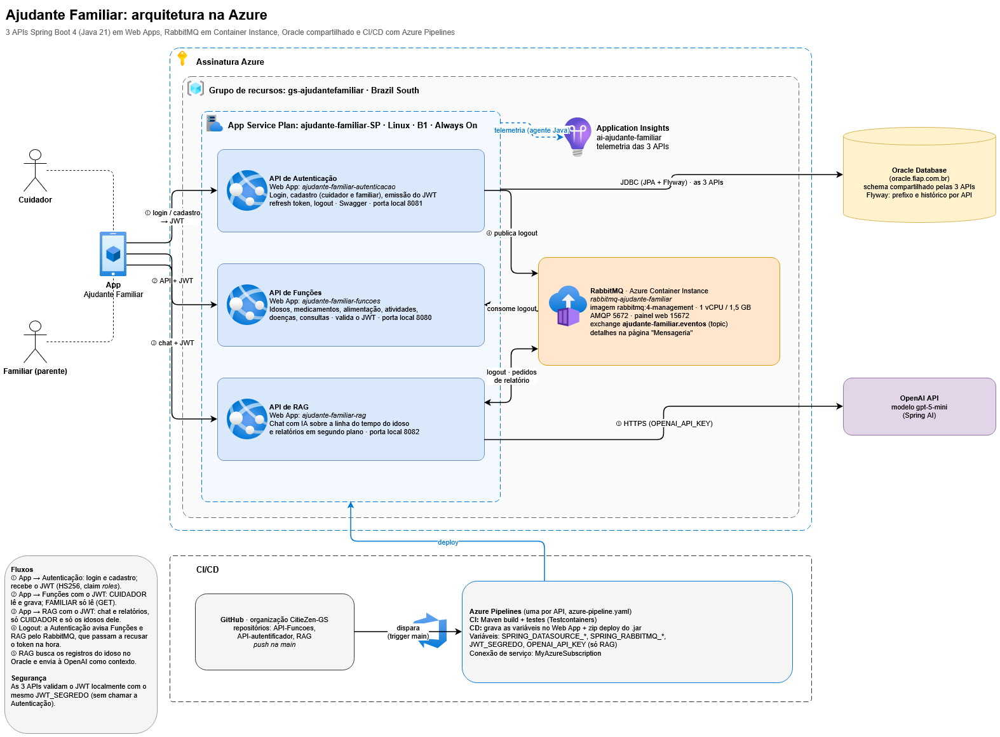
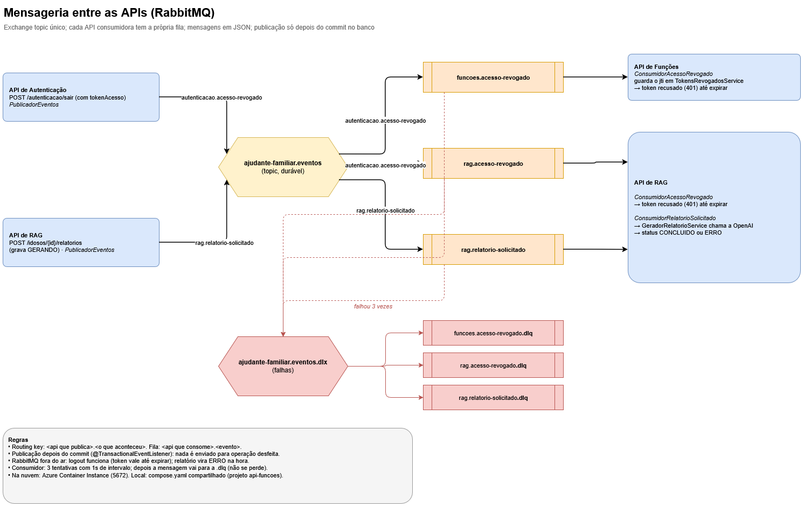

# Ajudante Familiar · API de Funções

Backend do **Ajudante Familiar**, a CitizenTech do grupo na Global Solution 2026/2 (FIAP · 2TDS). Esta API guarda e entrega tudo o que o cuidador registra sobre o idoso: dados de saúde, doenças, medicamentos, atividades, alimentação e lembretes de consulta. É a API consumida pelo app Mobile e o serviço publicado na Azure pelas pipelines do Azure DevOps.

## Integrantes

| Nome | RM |
|---|---|
| Gabriel Fachin de Oliveira | RM561551 |
| Fernando Charlles Faustino Fernandes | RM566482 |
| Iago D. Ainette | RM565708 |
| Leticia Santiago | RM565799 |

## Links

| O quê | Endereço |
|---|---|
| API de funções (este repositório) | https://github.com/CitieZen-GS/API-Funcoes |
| API de autenticação (JWT) | https://github.com/CitieZen-GS/API-autentificador |
| API de RAG (IA generativa) | https://github.com/CitieZen-GS/RAG |
| App Mobile | https://github.com/CitieZen-GS/Mobile |
| Deploy da API de funções (Swagger) | https://ajudante-familiar-funcoes.azurewebsites.net/swagger-ui.html |
| Deploy da API de autenticação (Swagger) | https://ajudante-familiar-autenticacao.azurewebsites.net/swagger-ui.html |
| Deploy da API de RAG (Swagger) | https://ajudante-familiar-rag.azurewebsites.net/swagger-ui.html |

> Endereços de deploy: confira o **Domínio padrão** de cada Web App no portal da Azure antes da entrega.

## O problema e a solução

O Brasil envelhece rápido: os idosos eram 8,7% da população em 2000, 15,6% em 2023 e devem chegar a 37,8% em 2070 (IBGE). Boa parte do cuidado fica com a família e com cuidadores que se revezam, e as informações da rotina (remédio dado, refeição, consulta marcada) se perdem em cadernos e mensagens.

O **Ajudante Familiar** centraliza essa rotina em um app com dois perfis:

- **Cuidador**: cadastra o idoso, doenças, medicamentos, atividades, alimentação e lembretes de consulta. Pode criar a conta de familiares do idoso.
- **Familiar**: acompanha tudo à distância, **somente leitura**.

Além disso, o cuidador conversa com uma IA que consulta a linha do tempo do idoso e gera relatórios (API de RAG).

## Arquitetura



Três microsserviços Spring Boot, cada um em um **Azure App Service** (Linux, Java 21, mesmo plano B3), um banco **Oracle Free** compartilhado (cada API cria só as próprias tabelas, via Flyway) e o **RabbitMQ**, ambos em **Azure Container Instances** e o **Application Insights** para monitoramento. Código, tarefas e pipelines ficam no **Azure DevOps** (Boards, Repos e Pipelines).

| Serviço | Responsabilidade | Porta local |
|---|---|---|
| **API de funções** (este) | CRUD do idoso e da rotina de cuidados | 8080 |
| API de autenticação | Cadastro, login e emissão do JWT com o papel (CUIDADOR ou FAMILIAR) | 8081 |
| API de RAG | Chat com IA sobre a linha do tempo do idoso e relatórios | 8082 |

Fluxo:

1. O app faz login na API de autenticação e recebe um JWT com o papel do usuário.
2. O app chama esta API com `Authorization: Bearer <jwt>`. A assinatura (HS256, segredo compartilhado `JWT_SEGREDO`) e o papel são validados aqui: **CUIDADOR** lê e escreve, **FAMILIAR** só lê.
3. No logout, a API de autenticação publica o evento `AcessoRevogadoEvento` no RabbitMQ. Esta API consome o evento da fila `funcoes.acesso-revogado` e passa a recusar aquele token na hora (401), sem esperar ele expirar.



### Requisito 5 de Java Advanced: opção escolhida

**Opção A: RabbitMQ.** Os eventos são publicados e consumidos de forma assíncrona:

| Evento | Publica | Consome | Efeito |
|---|---|---|---|
| `AcessoRevogadoEvento` | API de autenticação (logout) | API de funções e API de RAG | o JWT revogado é recusado na hora |
| `RelatorioSolicitadoEvento` | API de RAG | API de RAG (consumidor em segundo plano) | o relatório é gerado pela IA sem travar a requisição |

Exchange `ajudante-familiar.eventos` (topic), filas com retentativa (3 tentativas) e fila de falhas (`.dlq`) para cada consumidor. A publicação acontece só depois do commit no banco.

## Tecnologias

- **Java 21**, **Spring Boot 4.1.2**, **Maven** (Maven Wrapper incluído)
- **Spring Web MVC**: API REST
- **Spring Data JPA** + **Oracle** (`ojdbc17`): persistência
- **Flyway**: migrations do banco (`M_AJ_V01` a `M_AJ_V12`)
- **Spring Security** + **OAuth2 Resource Server**: validação do JWT e dos papéis
- **Spring AMQP**: RabbitMQ
- **Bean Validation**: validação dos DTOs, com tratamento global de erros (`@RestControllerAdvice`)
- **springdoc-openapi 3.1.0**: Swagger / OpenAPI
- **Spring Boot Actuator**, **Lombok**
- **Spring Boot Docker Compose**: sobe Oracle e RabbitMQ em desenvolvimento
- Testes: **JUnit 5**, **Spring Boot Test**, **Testcontainers** (Oracle Free e RabbitMQ)

## Estrutura do repositório

```
API-Funcoes/
├── azure-pipeline.yml          # CI/CD no Azure Pipelines (build, testes e deploy)
├── dockerfiles/
│   └── compose.yaml            # Oracle e RabbitMQ para desenvolvimento local
├── docs/                       # desenho da arquitetura
├── scripts/
│   ├── azure-infra.sh          # Azure CLI: toda a infraestrutura (igual nos 3 repositórios)
│   ├── sincronizar-infra.sh    # confere ou replica os scripts de infra nos 3 repositórios
│   └── script-bd.sql           # DDL de todas as tabelas desta API
├── src/main/java/on/fiap/com/br/AjudanteFamiliar/
│   ├── controller/             # rotas HTTP e tratamento global de erros
│   ├── services/               # regras de negócio
│   ├── repositories/           # acesso ao banco
│   ├── models/                 # entidades JPA
│   ├── dto/                    # entrada e saída da API (com Bean Validation)
│   ├── mensageria/             # RabbitMQ: eventos, filas e consumidores
│   └── configuracoes/          # segurança (JWT) e OpenAPI
├── src/main/resources/
│   ├── application.yml
│   └── db/migration/           # migrations Flyway
├── src/test/java/              # testes automatizados
├── .env.example                # variáveis de ambiente, sem credenciais
└── pom.xml
```

## Modelo de dados

| Tabela | Relacionamentos |
|---|---|
| `T_Ajudante_familiar_Cargo` | 1:N com Perfil |
| `T_Ajudante_familiar_Perfil` | pertence a um Cargo; 1:N com Cuidador e Parente |
| `T_Ajudante_familiar_Cuidador` | pertence a um Perfil; 1:N com Idoso |
| `T_Ajudante_familiar_Idoso` | pertence a um Cuidador; 1:N com Parente, Doenças, Atividades, Alimentação, Medicamentos e Lembretes de consulta |
| `T_Ajudante_familiar_Parente` | pertence a um Idoso e a um Perfil |
| `T_Ajudante_familiar_Doencas`, `_Atividades`, `_Alimentacao`, `_Medicamentos`, `_Lembrete_Consulta` | pertencem a um Idoso |
| `T_Ajudante_familiar_Consulta_Medicamento` | N:N entre Lembrete de consulta e Medicamento |
| `LOGS` | registro de erros de procedures |

O DDL completo está em [`scripts/script-bd.sql`](scripts/script-bd.sql). Na aplicação, quem cria as tabelas é o Flyway, com os mesmos arquivos.

## Como rodar localmente

### Pré-requisitos

- **JDK 21** (`JAVA_HOME` apontando para ele)
- **Docker Desktop** aberto, com o motor rodando ("Engine running") e em modo **Linux containers** (no Windows, requer WSL 2)

Não é preciso instalar Maven, Oracle nem RabbitMQ: o projeto usa o Maven Wrapper e sobe os serviços pelo `dockerfiles/compose.yaml`.

### Subindo a aplicação

Na raiz do projeto:

```bash
# Windows (PowerShell)
.\mvnw spring-boot:run

# Linux / macOS
./mvnw spring-boot:run
```

O Spring Boot executa o `docker compose up` com o arquivo `dockerfiles/compose.yaml`, espera o Oracle ficar saudável, conecta com as credenciais do compose e o Flyway cria as tabelas. Na primeira execução, o download da imagem do Oracle pode levar alguns minutos. Ao encerrar a aplicação, os containers que ela subiu são parados.

**Ordem para o sistema completo:** suba esta API primeiro (ela cria as tabelas base), depois a [API de autenticação](https://github.com/CitieZen-GS/API-autentificador) e a [API de RAG](https://github.com/CitieZen-GS/RAG). As três usam os mesmos containers de Oracle e RabbitMQ.

### Serviços e portas

| Serviço | Endereço | Credenciais (só desenvolvimento) |
|---|---|---|
| API | http://localhost:8080 | JWT (ver [Usuários de teste](#usuários-de-teste)) |
| Swagger UI | http://localhost:8080/swagger-ui.html | público |
| Oracle Free | `localhost:1521`, serviço `FREEPDB1` | `ajudante` / `secret` (admin: `system` / `secret`) |
| RabbitMQ (AMQP) | `localhost:5672` | `myuser` / `secret` |

### Acessando o banco (Oracle SQL Developer)

Nova conexão: usuário `ajudante`, senha `secret`, tipo **Básico**, host `localhost`, porta `1521` e **Nome do serviço** `FREEPDB1`. As tabelas ficam no schema `AJUDANTE`.

Para usar o banco sem a aplicação rodando:

```bash
docker compose -f dockerfiles/compose.yaml up -d oracle   # sobe só o banco
docker compose -f dockerfiles/compose.yaml stop           # desliga, mantendo os dados
```

> `docker compose ... down` remove os containers e, como não há volume, **apaga os dados do banco**.

### Variáveis de ambiente

Em desenvolvimento nenhuma é obrigatória. Fora do Docker Compose (Azure ou `java -jar`), defina as variáveis abaixo. O arquivo [`.env.example`](.env.example) traz o modelo, sem credenciais.

| Variável | Descrição |
|---|---|
| `SPRING_DATASOURCE_URL` | ex.: `jdbc:oracle:thin:@//host:1521/FREEPDB1` |
| `SPRING_DATASOURCE_USERNAME` / `SPRING_DATASOURCE_PASSWORD` | usuário e senha do Oracle |
| `SPRING_RABBITMQ_HOST` / `SPRING_RABBITMQ_PORT` | endereço e porta do RabbitMQ |
| `SPRING_RABBITMQ_USERNAME` / `SPRING_RABBITMQ_PASSWORD` | usuário e senha do RabbitMQ |
| `JWT_SEGREDO` | segredo HS256 dos tokens, mínimo 32 caracteres, **igual nas 3 APIs** |

### Problemas comuns

| Erro | Causa e solução |
|---|---|
| `mvnw` não é reconhecido | no PowerShell, use `.\mvnw` |
| `failed to connect to the docker API` | Docker Desktop fechado ou iniciando: abra e espere "Engine running" |
| `ORA-01017: invalid credential` | container antigo: `docker compose -f dockerfiles/compose.yaml down` e suba de novo |
| `port is already allocated` | porta 1521 ou 5672 em uso: altere o número da esquerda no `dockerfiles/compose.yaml` |

## Usuários de teste

As contas são criadas pela API de autenticação. Crie este par de usuários uma vez (local em `http://localhost:8081` ou no deploy da autenticação) e use-o nos testes e na demonstração:

| Papel | E-mail | Senha | Pode |
|---|---|---|---|
| CUIDADOR | `maria.cuidadora@ajudante.com` | `senha123` | ler e escrever |
| FAMILIAR | `ana.familiar@ajudante.com` | `senha123` | só ler (GET) |

1. Crie a cuidadora (rota pública). A resposta já traz o `tokenAcesso` e o `usuario.id`:

   ```http
   POST /autenticacao/cadastro/cuidador
   { "nome": "Maria", "email": "maria.cuidadora@ajudante.com", "senha": "senha123" }
   ```

2. Com o token da cuidadora, cadastre um idoso nesta API (`POST /idosos`, exemplo em [CRUD em JSON](#crud-em-json)) usando `idCuidador` = `usuario.id`.
3. Com o token da cuidadora, crie a familiar ligada a esse idoso:

   ```http
   POST /autenticacao/cadastro/parente
   Authorization: Bearer <tokenAcesso da cuidadora>
   { "nome": "Ana", "email": "ana.familiar@ajudante.com", "senha": "senha123", "idIdoso": 1 }
   ```

4. Depois, para obter um token: `POST /autenticacao/login` com `{ "email": "...", "senha": "senha123" }`. No Swagger desta API, clique em **Authorize** e cole o `tokenAcesso` (sem o prefixo `Bearer`).

## Endpoints principais

Documentação interativa em **/swagger-ui.html** e OpenAPI em `/v3/api-docs`. Todas as rotas exigem `Authorization: Bearer <jwt>`: **CUIDADOR** usa todos os métodos, **FAMILIAR** só `GET`. Datas no formato `aaaa-mm-dd` e horas em `hh:mm`.

| Recurso | Método e rota | Descrição |
|---|---|---|
| Idoso | `GET /idosos?idCuidador=` | lista idosos (filtro opcional por cuidador) |
| | `GET /idosos/{id}` | busca um idoso |
| | `GET /idosos/{id}/resumo?data=` | resumo do dia: doenças, medicamentos, atividades, alimentação e próximas consultas |
| | `POST /idosos` · `PUT /idosos/{id}` · `DELETE /idosos/{id}` | cadastra, atualiza, remove |
| Doenças | `GET/POST /idosos/{idIdoso}/doencas` | lista / cadastra |
| | `GET/PUT/DELETE /doencas/{id}` | busca / atualiza / remove |
| Medicamentos | `GET/POST /idosos/{idIdoso}/medicamentos` | lista / cadastra |
| | `GET/PUT/DELETE /medicamentos/{id}` | busca / atualiza / remove |
| Atividades | `GET /idosos/{idIdoso}/atividades?data=` · `POST /idosos/{idIdoso}/atividades` | lista (filtro por dia) / cadastra |
| | `GET/PUT/DELETE /atividades/{id}` | busca / atualiza / remove |
| Alimentação | `GET /idosos/{idIdoso}/alimentacoes?data=&tipo=` · `POST /idosos/{idIdoso}/alimentacoes` | lista (filtros por dia e tipo) / cadastra |
| | `GET/PUT/DELETE /alimentacoes/{id}` | busca / atualiza / remove |
| Lembretes de consulta | `GET /idosos/{idIdoso}/lembretes-consulta?status=` · `POST /idosos/{idIdoso}/lembretes-consulta` | lista (filtro por status) / cadastra |
| | `GET/PUT/DELETE /lembretes-consulta/{id}` | busca / atualiza / remove |
| | `PATCH /lembretes-consulta/{id}/status` | marca como `REALIZADO` ou `PENDENTE` |
| | `POST/DELETE /lembretes-consulta/{id}/medicamentos/{idMedicamento}` | vincula / desvincula medicamento |

Erros padronizados (`ErroResposta`): `400` dados inválidos, `401` sem token ou token revogado, `403` papel sem permissão, `404` não encontrado, `409` conflito com o banco, `422` regra de negócio.

## CRUD em JSON

Exemplos prontos para o Swagger, Postman ou Insomnia, com o token da cuidadora. Depois de cada operação, confira direto no banco com o `SELECT` indicado.

### Tabela `T_Ajudante_familiar_Idoso`

```http
POST /idosos
{
  "nome": "José da Silva",
  "cpf": "123.456.789-09",
  "altura": 1.70,
  "peso": 72.50,
  "dataNascimento": "1945-03-12",
  "comportamento": "Calmo, gosta de caminhar pela manhã",
  "idCuidador": 1
}
```

```http
PUT /idosos/1
{
  "nome": "José da Silva",
  "cpf": "123.456.789-09",
  "altura": 1.70,
  "peso": 70.00,
  "dataNascimento": "1945-03-12",
  "comportamento": "Mais cansado à tarde",
  "idCuidador": 1
}
```

`GET /idosos/1` · `DELETE /idosos/1` (remova antes os registros ligados a ele, senão a API responde `409`).

```sql
SELECT id_idoso, nm_idoso, vlr_peso, ds_comportamento FROM T_Ajudante_familiar_Idoso;
```

### Tabela `T_Ajudante_familiar_Medicamentos`

```http
POST /idosos/1/medicamentos
{
  "nome": "Losartana 50mg",
  "viaAdministracao": "Oral",
  "frequencia": "1 vez ao dia",
  "instrucaoUso": "Tomar após o café da manhã",
  "data": "2026-11-19",
  "hora": "08:00"
}
```

```http
PUT /medicamentos/1
{
  "nome": "Losartana 50mg",
  "viaAdministracao": "Oral",
  "frequencia": "2 vezes ao dia",
  "instrucaoUso": "Após o café e após o jantar",
  "data": "2026-11-19",
  "hora": "08:00"
}
```

`GET /idosos/1/medicamentos` · `GET /medicamentos/1` · `DELETE /medicamentos/1`

```sql
SELECT id_medicamentos, nm_medicamentos, vl_frquencia, hr_medicamento, id_idoso FROM T_Ajudante_familiar_Medicamentos;
```

### Outras tabelas

```http
POST /idosos/1/doencas
{ "nome": "Hipertensão", "descricao": "Controlada" }

POST /idosos/1/atividades
{ "nome": "Caminhada", "descricao": "30 minutos no parque", "data": "2026-11-19", "horaInicio": "09:00", "horaFim": "09:30" }

POST /idosos/1/alimentacoes
{ "nome": "Arroz, feijão e frango", "tipo": "ALMOCO", "dataConsumo": "2026-11-19", "horaConsumo": "12:30", "calorias": 650.00, "preparacao": "Pouco sal" }

POST /idosos/1/lembretes-consulta
{ "titulo": "Cardiologista", "nomeMedico": "Dr. Paulo", "dataConsulta": "2026-12-02", "horaConsulta": "14:00", "descricao": "Levar exames" }

PATCH /lembretes-consulta/1/status
{ "status": "REALIZADO" }
```

O `tipo` da alimentação aceita `CAFE_DA_MANHA`, `ALMOCO`, `LANCHE_DE_TARDE` ou `JANTAR`.

## Testes automatizados

```bash
./mvnw test
```

Os testes usam **Testcontainers** (Oracle Free e RabbitMQ reais), então o Docker precisa estar aberto. Na pipeline, rodam a cada build e os resultados (JUnit) aparecem na aba **Tests** da execução.

| Classe | O que verifica |
|---|---|
| `AjudanteFamiliarApplicationTests` | a aplicação sobe com banco, migrations e RabbitMQ |
| `RevogacaoTokenTests` | token válido é aceito; token revogado no logout é recusado; revogar um token não afeta outros; evento inválido vai para a fila de falhas |

## Deploy na Azure (DevOps)

### 1. Infraestrutura (Azure CLI)

O script [`scripts/azure-infra.sh`](scripts/azure-infra.sh) é **o mesmo arquivo nos 3 repositórios** e cria **toda** a infraestrutura do sistema, no grupo `gs-ajudantefamiliar` (região `brazilsouth`):

- Application Insights `ai-ajudante-familiar`
- Plano do App Service `ajudante-familiar-SP` (Linux, B3: 4 vCPUs e 7 GB para as 3 APIs)
- Os 3 Web Apps, `ajudante-familiar-funcoes`, `ajudante-familiar-autenticacao` e `ajudante-familiar-rag` (Java 21, Always On, ligados ao Application Insights)
- RabbitMQ `rabbitmq-ajudante-familiar` no Azure Container Instance (imagem `rabbitmq:4-management`, portas 5672 e 15672). A senha é digitada ao rodar o script e não fica salva.
- Banco Oracle `oracle-ajudante-familiar` no Azure Container Instance (imagem `gvenzl/oracle-free:23-slim-faststart`, porta 1521, serviço `FREEPDB1`, usuário `ajudante`). As senhas do usuário e do administrador são digitadas ao rodar o script. Sem volume: se o container for recriado, os dados se perdem, e basta rodar de novo a pipeline desta API (o Flyway recria as tabelas) antes das outras duas.

```bash
az login
bash scripts/azure-infra.sh
```

Basta rodar **uma vez**, de qualquer um dos repositórios. Recursos que já existem são mantidos, então o script pode ser executado de novo sem duplicar nada (a senha do RabbitMQ só é pedida na criação). No fim, ele mostra o endereço de cada Web App e os valores do RabbitMQ para as variáveis das pipelines. Se algum comando falhar, o script para na hora e mostra o que falhou.

Para alterar o script, edite a cópia de um dos repositórios e rode `bash scripts/sincronizar-infra.sh --copiar` para replicá-la nos outros dois (os 3 repositórios precisam estar clonados lado a lado). Sem opção, `bash scripts/sincronizar-infra.sh` só confere se as 3 cópias estão iguais.

### 2. Azure DevOps

- **Boards**: cada mudança começa por uma tarefa; commits, branch e pull request são vinculados a ela (`AB#<id>` na mensagem).
- **Repos**: branch `main` protegida (revisor obrigatório, work item vinculado e revisor padrão). As mudanças entram por pull request.
- **Pipelines**: [`azure-pipeline.yml`](azure-pipeline.yml), disparado automaticamente a cada merge na `main`.

| Estágio | O que faz |
|---|---|
| **CI** | Java 21, `mvn clean package` com os testes, publica os resultados JUnit e o `.jar` como artefato `app` |
| **CD** | roda sozinho após a CI: grava as variáveis de ambiente no Web App e publica o `.jar` (Zip Deploy) |

Variáveis da pipeline (Pipeline > Edit > Variables), com as senhas marcadas como secretas:

| Variável | Secreta |
|---|---|
| `SPRING_DATASOURCE_URL`, `SPRING_DATASOURCE_USERNAME` | não |
| `SPRING_DATASOURCE_PASSWORD` | **sim** |
| `SPRING_RABBITMQ_HOST`, `SPRING_RABBITMQ_PORT`, `SPRING_RABBITMQ_USERNAME` | não |
| `SPRING_RABBITMQ_PASSWORD` | **sim** |
| `JWT_SEGREDO` | **sim** |

Nenhuma senha fica no código: em desenvolvimento são usadas as do `dockerfiles/compose.yaml` (só locais) e, na nuvem, as variáveis da pipeline.

## Declaração de uso de IA

- **Na solução:** a funcionalidade de IA generativa (chat sobre a linha do tempo do idoso e relatórios) fica na [API de RAG](https://github.com/CitieZen-GS/RAG), com Spring AI e modelo da OpenAI. Esta API não chama modelos de IA.
- **No desenvolvimento:** o grupo usou o assistente Claude (Anthropic) como apoio na escrita de código, configuração das pipelines e scripts, testes e documentação. Todo o conteúdo gerado foi revisado, testado e ajustado pelos integrantes, que respondem por ele.
